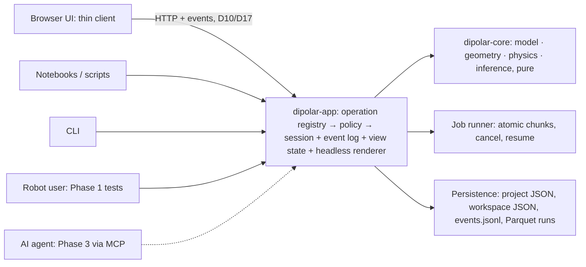

# Dipolar Studio — consolidated redesign plan

**Version 0.6** · 2026-11-07 · Status: **draft for the owner's approval as the Phase-1
execution baseline.**

Changes in v0.6: the owner added a **verification phase**, so the roadmap now has three phases:

1. foundation and the biphenyl beta;
2. **verification**: further molecule classes, models and measurement types. Selected,
   implemented extensions get known-answer verification and, where suitable experimental data
   exist, a preregistered experimental comparison. Reports keep the synthetic-only and
   unresolved-failure outcomes (§4, §8);
3. AI integration.

GPT-6.1-Sol round 6 ([round6-verification-phase.md](validation/round6-verification-phase.md))
judged the first Phase 2 draft *not ready*. All ten required changes are applied, and the
confirmatory round 7 (*ready with minor changes*; its three consistency fixes are also applied)
is recorded in the same file:

- model-specific identifiability gates instead of blanket exact recovery;
- executable rank and scale tests;
- permutation classes instead of point-group "equivalence";
- a complete ²H EFG specification and declared total-coupling conventions;
- the restored ¹³C coplanarity rule;
- a conditional AP-DPD reproduction gate;
- the terphenyl dataset corrected to ¹³C–¹⁹F;
- "no architectural change" replaced by schema-evolution rules;
- a holdout policy;
- a bounded first verification release (V0 + V1), with separate status labels.

**Naming note:** in v0.5 and in validation rounds 1–5, "Phase 2" means the AI phase, which is
now **Phase 3**.

v0.5 applied all ten required changes from GPT-6.1-Sol round 4
([round4-ai-architecture-review.md](validation/round4-ai-architecture-review.md), verdict on
v0.4: *not ready*). The confirmatory round 5 returned *ready with minor changes*
([round5-confirmation.md](validation/round5-confirmation.md)), and those changes are applied here.

Changes in v0.5 (from round 4):
- A corrected equivalence statement.
- Repaired M1 acceptance gates (noiseless, regression and coverage; weighted vs unweighted).
- Binding state, replay, policy, perception, registry and MCP contracts (04 §8).
- A smaller vertical-slice M0.
- Minimum safety gates before any user sees the assistant.
- Dataset provenance and the basis for publishing it.

v0.4 added the owner's decisions (biphenyl, browser, BSD-3, a public repo), the AI-ready
architecture (D13–D20) and the two-phase roadmap. v0.3 had been judged *ready with minor
changes* in round 3.

Inputs:

- [Legacy analysis](legacy/01-legacy-analysis.md)
- [Bug report](legacy/02-bug-report.md): 56 retained findings, reconciled in place.
- Panel reports: [UX research](panel/ux-research.md), [UI design](panel/ui-design.md) with its [mockup](panel/mockup-workspace.html), [science & numerics](panel/science-numerics.md), and [architecture](panel/architecture.md).
- Architecture extension: [04-ai-ready-architecture.md](04-ai-ready-architecture.md) (headless engine, operation registry, AI readiness).
- Datasets: [datasets/](../datasets/) (synthetic biphenyl with a known answer; experimental biphenyl in 8CB).
- Validation: [round 1, bugs](validation/round1-bug-verification.md), [round 2, plan](validation/round2-plan-review.md) and [round 3, re-review](validation/round3-rereview.md).

**Order of precedence:** validated findings in `02-bug-report.md` and `validation/` override
the panel documents. Panel statements contradicted by validation are listed in §11 and should
be read as historical proposals.

---

## 1. Vision

> **Answer "which conformations and order matrices agree with my couplings, and how sure am
> I?" with honest uncertainty and a reproducible record.**

What the legacy code got right: the standard dipolar tensor contraction
`D = K·r⁻³·uᵀSu` is sound. What remains qualified or unverified:

- the geometry construction;
- the symmetry and frame conventions (especially legacy "D4", B55);
- the ρ-distortion assumptions;
- several solve and report paths.

Three legacy ideas are worth keeping:

1. Fragments with parameters bound to geometry.
2. Explicit averaging ("components").
3. Scanning the conformational space globally.

**The product is a fit, not a molecule editor.**

## 2. What the evidence says the legacy got wrong

| Failure class | Examples (bug IDs) | Design response |
|---|---|---|
| Untrustworthy numerics | Szz = 99 (B01); eigenvalue errors up to 0.12 on ordinary matrices (B04); 14 instead of 3 (B06); silent singular solves (B07, B58) | Stable library factorizations only (§3 D3). Rank and validity are reported for every solve. Goldens from the legacy harness. |
| Fitting is not statistics | Exact solve from 2–3 hand-picked couplings; a tolerance of 10·\|Dobs\| that is not saved (B08, B54); the solve and the prediction disagree (B47, B55) | One forward model used both for fitting and for prediction. A weighted likelihood with explicit error assumptions. |
| String references and stale state | A missing label becomes (0,0,0) (B11); stale selections and copies (B46); orphan couplings (B29) | Immutable IDs. Revision-tagged state with no input copies. Results are marked stale when their inputs change. |
| Geometry by special cases | `atan` (B12), biphenyl axis (B13), zero axes (B14, B56), cylinder direction (B50) | A single Cartesian forward model (NeRF, `atan2`, quaternions) with property tests. |
| Data loss and corruption | Unsaved bindings (B19); paging that mixes records (B49, B51); writes that are not atomic (B57) | Durable-save and immutable-run contract (§3 D11). |
| Memory unsafety | B16, B17, B34, B53 | Memory-safe implementation languages. |

## 3. Key decisions

Each decision becomes an ADR in M0.

**D1 — Python API-first core.** NumPy/SciPy in float64. Numba or JAX is introduced only after
profiling shows a hot path. *Revisit* if measured end-to-end latency targets fail after
profiling (not at an arbitrary points-per-second figure), or if the browser needs compute without
Python. The kernel boundary allows a Rust (PyO3) replacement later.

**D2 — UI on web technology.** React + TS (strict) with a react-three-fiber viewer. **The
beta's only UI path is the browser** (owner decision, 2026-11-07): `dipolar serve` opens the app
on localhost. The UI is a thin client of the operation registry (D13). A Tauri desktop shell is
deferred until after the beta.

**D3 — Scientific and inference contract.** This is a binding requirement for M1.

1. **Forward model.** A float64 Cartesian forward model. With `LᵀL = Σ⁻¹`, `B = L·A(g)·C(g)`
   and `b = L·y`, the inner solve is `t* = argmin ‖Bt − b‖²`, computed by **SVD or pivoted QR**.
   Normal equations are not used as the reference path. Both the data and the design matrix are
   whitened. The *residual vector* (`Bt* − b`) is passed to `scipy.optimize.least_squares`.
2. **Optimizer.** The geometry is fitted with a **bounded trust-region** method (`method="trf"`;
   LM does not support bounds). The search is a small grid or Sobol multistart followed by
   local refinement. Competing basins are reported, not hidden.
3. **Error models and likelihood.** The baseline likelihood is Gaussian with a fixed,
   positive-definite covariance Σ: diagonal by default, or a full Σ supplied through the API.
   χ² = ‖r‖² = **2·`result.cost`** for the linear loss (SciPy minimizes half the squared norm).
   A known-σ covariance is **not** rescaled automatically by χ²ᵥ; when rescaling is an option it
   is labelled. Rows copied by symmetry are distinguished from genuinely independent repeated
   measurements. The default diagonal model with σ taken from the data. The API
   also accepts a full covariance, because couplings from one spin-Hamiltonian fit may have
   correlated errors. The source of each uncertainty is recorded. Equivalent or multiplicity rows
   do not inflate N. An optional model-error floor is recorded separately and checked by
   sensitivity, never tuned to reach χ²ᵥ ≈ 1.
4. **Uncertainty.** Covariance comes from the **full Jacobian** in the joint coordinates
   (order + geometry), not from the reduced VarPro Jacobian. The weighting convention of J is
   stated, so weights are not applied twice. Unidentified directions are named and are never given
   finite pseudo-inverse error bars. **Profiles** (other parameters re-minimized) are distinguished
   from **slices** (other parameters held fixed). Thresholds are regular-model approximations, given as raw Δχ²:
   1.00 for a 68.3% one-parameter interval, 3.84 for a 95% one-parameter interval, and 2.30 for a
   68.3% joint two-parameter region, with the confidence level always labelled. Intervals that
   are asymmetric or separated by mode are reported where needed. Simulation-based errors repeat
   the full multibasin search. At parameter boundaries, rank changes or unidentified modes
   (Self–Liang conditions), an interval is either calibrated by coverage simulation or shown with
   the explicit status **"interval not supported"**.
5. **Independent validity flags.** Each grid point and each fit records, *independently*:
   - the inner-design rank and condition number;
   - the joint-J rank;
   - optimizer convergence;
   - physical admissibility (`(2S+I)/3 ⪰ 0`);
   - interval support.

   "Full rank" can coexist with a physically inadmissible optimum. For rank-deficient points, the
   minimum-norm S is only *one representative*: if it is inadmissible, other tensors in the
   null-space-equivalent family might not be, and the UI says so. Enforcing admissibility needs a
   constrained inner solve (an opt-in model, not the default). The rank tolerance and condition
   thresholds are written policies. **Convergence, adequacy and identifiability are separate
   indicators** in the UI.
6. **Degrees of freedom.** For a regular, identifiable interior model, ν = N − p_free, where
   p_free counts the free order and geometry parameters together (the NIST convention). The
   **joint rank** of the whitened full Jacobian J is reported separately. Outside the regular
   case, N − rank(J) is only a diagnostic of the local residual dimension: geometry directions
   that the order parameters absorb must not be counted twice. A negative nominal ν flags
   underdetermination, and ν = 0 does not prove uniqueness. Active inequality bounds do not
   justify simply subtracting parameters.
7. **M1 gate.** Before M1 is accepted, these must pass:
   - analytical coefficient tests;
   - a weighted-projection control case (A = (1,1)ᵀ, y = (0,1)ᵀ, L = diag(1,2) gives t* = 0.8, χ² = 0.8);
   - planar and rank-changing controls;
   - full fit and reduced fit agree;
   - simulation-based coverage of intervals for the supported model.

The legacy method survives as `method="legacy_exact"` for audits only.

**D4 — Molecule = graph + torsion tree.** The beta uses fixed imported or template coordinates
with permitted inter-fragment torsions. Free-form editing, and geometry changes that involve
rings, come later.

**D5 — Stable IDs; labels are for display only.** Valid IDs do **not** prove that an
assignment is correct. Reconciliation keeps the original labels, requires the user to confirm
the mapping, and shows a reviewable import diff. There is no "validated assignment" badge.

**D6 — Formats.**

- `*.dipolar.json`: schema-versioned, with migrations.
- Runs: `run.json` (an immutable snapshot of the inputs, its hash, versions and seed) plus
  Parquet chunks.
- The legacy importer is **gated** (§8, M-L).

**D7 — Observables and conventions.**

- **Constant.** `K = −(μ0/4π)·γiγj·ħ/(2π)`, using angular γ from a versioned nuclide table
  (IUPAC). The SI result is in Hz·m³; multiply by 10³⁰ for Hz·Å³ when r is in Å.
  Couplings are stored in Hz.
- **Observable record.** The raw value and unit, the observable type, the sign status, the
  isotopes, the uncertainty and its source, and for total couplings the J reference with its
  uncertainty.
- **Beta scope.** Signed dipolar D only. `T = J + 2D` is a convention specific to each dataset.
  ²H quadrupolar data is a **single-site EFG observable** (q, EFG orientation and asymmetry,
  sign knowledge) with its own schema. Both enter later, behind validation datasets.
- **Order matrix.** `S = ½⟨3ccᵀ − I⟩`, alignment tensor `A = ⟨ccᵀ⟩ − I/3`, so `A = (2/3)S`.
  Principal values are ordered |Szz| ≥ |Syy| ≥ |Sxx|. `η = (Sxx − Syy)/Szz` is in [0,1] and
  undefined when S = 0. Axes for degenerate principal values are labelled **nonunique**: a
  display convention fixes how they are drawn, but they are not measured directions. The
  symmetry frame and the sorted principal frame are kept separate.

**D8 — The UI is a client of the engine.** The Python API and CLI come first. **Third-party
plugin APIs are frozen only after a real second model exposes the boundary.**

**D9 — Licence.** **BSD-3-Clause, decided by the owner on 2026-11-07**, for the software they own. Third-party datasets keep their own terms (see each dataset's README). The project is an **independent reimplementation
informed by review of the legacy source** (not a clean-room rewrite). The BSD-3 decision stands. Before any
**packaged release** (for example on PyPI), two checks remain: confirming ownership of the 1998
code and thesis material, and auditing the licences of all dependencies. CITATION.cff is in
place; a Zenodo DOI comes at the first release.

**D10 — Security and lifecycle of the local backend (new).**

- **Binding.** Loopback only, an OS-assigned port, and an authenticated readiness handshake.
  Detect multiple instances and reused ports.
- **Secret.** Per-launch, passed over private IPC, never in URLs, command lines, logs or project
  files. Every sensitive endpoint, including the progress streams, is authenticated. Because
  `EventSource` cannot send an Authorization header, the stream uses authenticated fetch
  streaming (a Tauri broker only if a desktop shell is added after the beta).
- **Request checks.** Validate Host and Origin, and reject unauthorized requests even when they
  carry no Origin. GET has no side effects. Strict CSP, local assets, escaped labels, sanitized
  report HTML. (The beta is browser-only; Tauri capabilities apply only if a desktop shell is added later.)
- **Resources.** Project-scoped file handles (no arbitrary paths). Bounded upload size, point
  count, memory and number of jobs. No shell, URL fetching or plugin selection from project
  files.
- **Processes.** Supervise the process tree, kill workers on exit, recover only committed chunks,
  and run CPU work outside the event loop.
- **Transport.** Choose HTTP vs stdio/IPC after a **packaged spike in M0**. Browser or JupyterHub
  serving is a separate deployment profile with user isolation, never the desktop server bound
  publicly.

**D11 — Durable runs and stale results (new).**

- Completed Parquet chunks and manifests are committed atomically; incomplete chunks are never
  results.
- Resume validates coverage and content.
- Editing a model marks earlier results **stale**. Previews carry revision IDs and late responses
  are discarded.
- Cross-platform agreement uses `atol + rtol·|ref|` per quantity. Byte identity applies only in
  a pinned, deterministic environment.
- **The canonical hash** covers the canonicalized model, the observations and covariance, the
  constants-table version, the solver and its settings, the plugin versions and the seed.
- **Publication order:** chunks are validated and fsynced before the manifest that references them
  is written. Orphan chunks without a manifest are ignored, and cleanup can remove them. The
  recovery policy is documented.
- **Tolerances are numeric and fixed before M2 acceptance.** For example: predictions
  atol 1e-9 Hz, rtol 1e-10; χ² rtol 1e-9; identifiable parameters rtol 1e-8. When axes are
  nonunique, predictions and invariant subspaces are compared, not raw axes.

**D12 — Model-specific identifiability and symmetry (new).**

- **Scale.** Under `r → λr`, `S → λ³S` the couplings are unchanged. Detect this scale freedom
  and require an anchor **only when the active model has it**: a fixed template or an imported
  geometry already provides one.
- **Reflections.** A whole-molecule reflection (r′ = Qr, S′ = QSQᵀ) cannot be distinguished by
  dipolar data. A single torsion's sign *can* be measurable in asymmetric or stereochemically
  anchored structures. Enumerate the model-specific equivalences (for example ±δ for an ideal
  symmetric biphenyl) and report the domain that was chosen.
- **Planar data.** Coplanar vectors determine at most three of the five S components, and
  collinear vectors at most one. Tests must state which constrained tensor they recover.
- **Symmetry naming.** Constraints are named by basis and frame. **C2(z)** keeps zz, xx−yy and
  xy (the legacy "D2"). A *diagonal tensor in a moving bisector frame* uses `Δ = Δ′cos δ`,
  `Sxy = ½Δ′ sin δ` (the legacy "D4"; this form is regular for every δ). D2 and D4 survive as
  legacy aliases only. At δ = 90°, the enhanced D2d symmetry of the identical-ring model forces
  Δ′ = 0, so that endpoint is either enforced or labelled as phenomenological. Parity with the
  legacy D4 model (B55) needs the thesis derivation.
- **Frozen frame contract (M1).** Document four things: active vs passive rotation, ring axes,
  the torsion sign convention, and the constraint basis C(g). Frame derivatives are included in
  the full Jacobian. Tests cover:
  - contraction invariance;
  - equivalence to the legacy model away from the pole;
  - the ideal D2d endpoint.

  D2d constraints apply only to an explicitly declared symmetric-ring model, never automatically
  to arbitrary substituted or imported geometry.

## 4. Product scope

### Phase 1: foundation + scientific beta (no AI features)

- **Biphenyl first** (owner decision). Template or imported coordinates; the inter-ring torsion
  as the free parameter; optionally the inter-ring bond length.
- **Two conformational models:**
  1. *rigid* (for synthetic truth);
  2. the **symmetric four-site jump** (±φ, 180±φ, equal populations, one order tensor shared in
     each conformer's acute-bisector frame).

  The experimental data have equalities (D13 = D13′, …) that the rigid model cannot fit. They are
  **consistent with** fast ±φ/180±φ interconversion but do not prove a unique equal-population
  four-site mechanism, since a continuous distribution also produces them. The jump model is the
  simplest model that respects them (`datasets/biphenyl-8CB-dipietro2013`).
  **Equivalences:** at fixed labels (±φ, Δ) are equivalent. (180±φ, −Δ) is equivalent only
  together with the ring-B relabelling H2′↔H6′, H3′↔H5′, applied to **both** endpoints of every
  pair. The jump model has **no
  population parameters**, so it avoids the population × tensor confounding that keeps general
  conformer averaging after the beta.
- **Isotope constants** from the nuclide table. **Signed dipolar D** with σ, the source of σ,
  and an optional model-error floor recorded separately.
- **The ¹³C coplanarity rule (binding for Phase 2 V4).** ¹³C labelling does not automatically
  remove planar rank deficiency. When all measured internuclear vectors remain coplanar,
  dipolar data constrain at most three tensor combinations. Additional in-plane vectors may
  improve rank or conditioning within that limit.
- **CSV import with reconciliation** (D5). Stable references, undo/redo, visibly stale results.
- **Order models:** the C2(z)/bisector-frame model (D12) plus the unconstrained C1 reference
  model.
- **The D3 inference stack:** SVD/QR, bounded VarPro, multibasin grid/multistart, independent
  validity flags, a profiled interval, residuals, and the estimand label ("rigid effective φ" vs
  "jump-model φ").
- **Immutable runs and records:** run snapshots, JSON/CSV, a deterministic HTML/CSV summary.
- **The headless application layer** (D13–D20): operation registry, session, event log, view
  state, headless rendering, actors/tiers, dry-run, proposals.
- **Clients:** the Python API, CLI and HTTP adapters, all generated from the registry.
- **The browser UI** (owner decision; the desktop app is deferred): a thin client of the
  registry with live preview, a coupling table, residuals and a 1D/2D landscape. Strings are
  externalized.

**What the beta processes.** The datasets in `datasets/` are *test fixtures*, not the only input.
Users load their own measured couplings (CSV, with σ) and their own geometry (the template or
XYZ). The Phase 1 limit is the **molecule class and its models** (biphenyl-type: two rings, one
inter-ring torsion, rigid or four-site jump), not the data.

### Phase 2: verification (owner decision, 2026-11-07; see §8)

Phase 2 widens the engine to the other molecule classes and measurement models that the 1998
application, or the literature, needs. Each one is **verified** against a known-answer synthetic
case and, where one exists, a published experimental dataset. In outline:

- a curated, citable benchmark corpus;
- **any rigid molecule from XYZ**: the legacy single phenyl ring, benzene and substituted benzenes;
- multi-torsion fragments: the legacy "triphenyl"/branched fragment and terphenyls;
- further symmetry and frame models: legacy D4 parity (B55) and the ρ ring-distortion model;
- new measurement types: ²H quadrupolar splittings, ¹³C–¹H and ¹H–¹⁹F couplings;
- conformational distributions: discrete conformers, AP/DPD and MaxEnt;
- a legacy-parity and thesis audit.

Phase 2 is expected to keep the application boundaries and session/policy semantics. Domain
schemas (observables, parameters, D19 outputs) evolve through D20 and migrations where needed
(§8). Only **V0 + V1** form the first, re-baselined verification release; V2–V5 are separately
conditional, and V3/V6 are gated on recovered thesis evidence. Each implemented model gets a
robot tutorial, and those tutorials become Phase 3 evaluation scenarios.

### Phase 3: AI integration (see §8)

The MCP adapter; agent-oriented composite tools; the in-app assistant with proposals and
approvals; view control by the agent; "explain this fit" and Methods drafting grounded in the
D19 fields; an agent evaluation suite and safety red-teaming.

### Later (each item needs its own acceptance gate)

| Item | Gate |
|---|---|
| Desktop installers (Tauri), Dask/SLURM, a stable third-party plugin API | Delivery evidence |
| Vibrational corrections, RDCs, RCSA, direct spectral fitting | Research tracks |

**1.0 date:** estimated only after the beta, from measured delivery.

## 5. The experience

The panel agrees on four workspaces (**Structure · Data · Fit · Report**) in one docked window.
The beta ships the Data and Fit workspaces plus a minimal Structure view. The interaction ideas
are adopted:

- ⇧-click two spins to create a coupling, and drag dihedral handles.
- Misfit arcs, with colour **and** width encoding the residual.
- Inspectors instead of dialogs, and undo for everything.

The round-2 review adds these requirements:

- **Live-preview contract.** p95 under 100 ms from gesture to fresh residuals on the beta fixture,
  warm. That is about 10 updates per second, not 60 Hz. Requests are coalesced and cancelled,
  and out-of-order responses are discarded. 3D drawing is measured separately.
- **Run status is never "green" by convergence alone.** The status bar shows convergence,
  adequacy and identifiability separately, plus a *stale* badge. (The mockup shows Fit 3 as
  "converged" after a later edit; that is exactly the stale state to avoid.)
- **A novice path and laptop widths.** Fixed side panes collapse. All reconciliation can be done
  from the keyboard. Every 3D operation has a table alternative.
- **Locale parsing is previewed and chosen, never guessed** (`1,234` is ambiguous). Display
  precision follows the uncertainty.

### Success metrics (operational)

| Metric | Definition |
|---|---|
| Time to a first valid fit | Fixed start and end events, dataset, installation state and help allowed. Report individual times, the median and the completion rate. A fast invalid fit counts as a failure. |
| Assignment errors | N seeded errors of declared types. Report escapes separately for *blockable* errors (malformed or ambiguous) and *plausible* wrong assignments. |
| Uncertainty comprehension | A scoring rubric (confidence level, assumptions, multiple minima, folding, the "not identifiable" case). Report counts with uncertainty; the result is formative only. |
| Scientific agreement | Kept separate: (a) numerical truth on synthetic data; (b) reproduction of the original method; (c) new-model inference against a **held-out** experimental dataset; (d) interval coverage in simulation. |
| Performance | Named hardware, fixture, algorithm, JIT state and output policy. p95 latency. Cancellation measured to the point where it is safe to commit. |

Before each study, a written protocol fixes:
- the task start and end events;
- the participant and novice denominators;
- the scoring rules;
- the cancellation-latency limits.

The benchmark corpus keeps **development/regression** cases and **experimental holdout** cases
distinct where both are available. Related observations are grouped so they do not leak
between the two. The model and criteria are frozen before a holdout is opened. Once opened, a
holdout becomes regression data, and the next independent evaluation needs a fresh holdout.
When none is available, "no independent experimental holdout" is reported, separately from
"synthetic-only".

Recruitment: 11–13 participants (roles listed in UX §7), with a defined number of novices.
Research checkpoints are aligned to the prototypes that actually exist.

## 6. Architecture summary

Full detail is in [04-ai-ready-architecture.md](04-ai-ready-architecture.md).

**Performance is a hypothesis, not an estimate.**

- **M1** publishes a pinned benchmark fixture: 10 spins, the 14 unique couplings of `datasets/biphenyl-synthetic` (plus an extended variant with 3 parameters), a fixed
  grid, plus an ill-conditioned case and a rank-changing case.
- **M2** records, on named hardware:
  - cold and warm timings, and kernel-only vs end-to-end timings;
  - 1-core vs multicore timings, peak RSS and output size;
  - the legacy acceptance rate;
  - numerical agreement, noting that the fit semantics differ from the legacy code.
- The "10²–10⁴×" and "≤ 10 s for 10⁶ points" figures are engineering targets until then.
- Chunk size is budgeted in bytes. With float64, 16k points at N = 10 already take about 43 MB;
  the 30 MB assumption is dropped.
- Nested BLAS, Numba and process thread pools are limited so they don't compete for cores.

## 7. Ideas beyond the panel (re-prioritized after review)

| Priority | Idea | Status |
|---|---|---|
| **Now** | **Open benchmark corpus.** A small set of cited datasets with reviewed rights. Each records its estimand (rigid effective angle vs distribution mean vs the maximum of P(φ)) and its conventions. | Promoted: it is the regression suite and the held-out test. |
| **Phase 2 (V6, conditional)** | **Thesis audit.** Re-run the thesis datasets as `legacy_exact` with bug compatibility, `legacy_exact` with the bugs fixed, and the new fit. | Depends on recovering the data. It does **not** block the engine. |
| Later, leading research candidate | **Experiment-design assistant.** Rank which unmeasured couplings or labels would most reduce σ(φ), using the Fisher information. | Needs a stable inference core. Novelty must be checked against the literature. |
| Later | Bayesian mode (NumPyro/emcee, DFT torsion priors) | Deferred until the frequentist core is validated. Sampling across multiple modes is hard. |
| Later | Zero-install teaching edition (Pyodide/JupyterLite) | Deferred until demand is shown |
| Later | Spectrum overlay (nmrglue, JCAMP-DX) | Deferred, because it needs the spin-Hamiltonian simulation done properly |
| **Phase 3** | **AI agent** that uses the registry tools to set up fits, run them, drive the view and explain results (D19 grounding). Methods drafting. | Phase 1 builds the foundation (D13–D20) with no AI code; Phase 3 adds the MCP adapter and the agent. It never invents numbers: every claim maps to a result field. |

## 8. Roadmap: three phases

**Phase order.** Phase 1 builds the foundation and the biphenyl beta; Phase 2 broadens and
verifies the science; Phase 3 adds AI. Phase 3 depends **technically** only on Phase 1 (the
04 §8 contracts). By default it follows the **first verification release (V0 + V1)**, for three
reasons:

- the agent then works on an engine verified on more than one molecule class;
- the Phase 2 robot tutorials become the A5 evaluation scenarios;
- the tool list has stabilized before the MCP surface is pinned (D20).

Phase 3 may also start from Phase 1 independently, for example alongside V2–V6. Gates do not move.

The owner builds this with AI-assisted development. Phase sizes are re-baselined after M0
from measured velocity; no calendar dates are fixed before then.

### Phase 1: foundation + scientific beta (no AI code)

| Milestone | Deliverables | Exit criteria |
|---|---|---|
| **M0 Foundations + vertical slice** | Monorepo, CI, ADRs D1–D20, legacy goldens, both datasets wired as tests. **One vertical slice end to end:** `fit.preview` on the synthetic fixture plus `view.select`, through a single typed dispatcher → policy → session (science and workspace revisions) → journal → Python and HTTP adapters → a minimal browser page and the robot. **Spikes:** the D3 numerical controls; JSON serialization of units, IDs and errors; D10 localhost controls (Host/Origin checks, CSRF, scoped token, DNS-rebinding negative tests); journal crash recovery | The slice passes the §8.6 checks it touches. Spikes pass or fail with evidence. Scope and velocity are re-baselined. |
| **M1 Scientific core** | Domain model, Cartesian forward model, nuclide table, the D3 stack, the rigid and four-site-jump models (explicit conformer averaging), C2(z) and C1, JSON v1, CSV/XYZ import | The D3 gate passes. **Fixture specs are frozen in M0** (`datasets/*/expected/`). They hold full-precision prediction vectors; per-quantity tolerances (predictions atol 1e-6 Hz, φ 1e-4°, S 1e-6 for regressions); the optimum convention (the **refined** bounded optimum seeded from the grid best, not the grid point; the rounded `check_fit.out.json` values serve only as ±0.05° and ±0.001 sanity bounds); and the coverage spec (1000 seeds, nominal 68.3%, acceptance band 64.5–72.1%, about a 99% binomial band). **Synthetic:** (a) exact recovery from noiseless couplings computed in code, not from the rounded CSV (φ, S_zz, Δ to 1e-8); (b) a fixed-seed noisy fixture as a numerical regression; (c) interval **coverage** calibrated on an ensemble of seeds, separately; (d) all 45 pairs, reversed pairs and the 90° endpoint give consistent predictions; (e) explicit four-conformer averaging equals the relabelling shortcut. **8CB:** the declared *unweighted* configuration reproduces φ, S_zz, Δ, RMS and the prediction vector at T_red 0.930 and 0.980 within numerical tolerances. The *weighted* configuration reports its fit with the inadequacy flag. The estimand is labelled. |
| **M2 Application layer + jobs** | Grow the slice into `dipolar-app`: operations added **only as the beta UI needs them**; global chronological undo; replay of recorded events; one shared view; actors and capabilities from credentials; dry run; proposals (dependency-closed, atomic); idempotency keys; jobs with input snapshots (§8.1); D11 runs; scene description + `describe_view` + SVG renderer with projection parity | All §8.6 checks pass. Replay reproduces the science hash. The registry snapshot, behavioural fixtures and contract tests pass on the Python and HTTP adapters. The benchmark is published. |
| **M3 Browser beta UI** | A thin React client on the generated TS client: Data and Fit workspaces, a minimal Structure view, reconciliation, live preview, stale badges, landscape, view sync from events | **The AI-readiness checklist (04 §7 + §8.6) is fully green**, including the robot completing the biphenyl tutorial in a clean process through HTTP only. The dependency-boundary and behavioural-parity tests pass. The preview p95 target is met on named hardware. |
| **Beta release** | Docs with executed notebooks, a summary report, `pip install` + `dipolar serve` | 2 or more external users reproduce the 8CB dataset on their own; 0 open S1 issues |
| **M-L Legacy import** *(parallel, gated)* | A CArchive spike, only once fixtures exist | As in v0.3; if not done in Phase 1, it moves to V6 |

### Phase 2: verification (starts after the beta; extends models and data within the Phase 1 application boundaries)

**Scope is bounded and re-baselined.** After the beta, the owner selects and re-baselines a
bounded **first verification release: V0 plus V1**.

- **V2–V5** are separate, conditional extensions. Each one is selected and re-baselined on its own.
- **V3 and V6** stay gated wherever they depend on the thesis or on recovered legacy evidence.
- **Phase 3 does not have to wait.** It may proceed from Phase 1 independently (see the phase
  order above).

**Rules for every V milestone:**

- **Frozen estimands and tolerances.** For each model, freeze the identifiable estimands, the
  equivalences and the numerical tolerances for each quantity **before** evaluation.
- **Noiseless recovery.** Noiseless tests recover the identifiable quantities and the
  predictions. Unidentified directions are reported, without finite error bars.
- **Regression and coverage are separate.** Fixed-seed regressions and coverage tests are run
  separately. The M1 protocol (1000 seeds, acceptance band 64.5–72.1%) applies to supported
  68.3% intervals. Boundary, regularized and nonregular cases need their own calibration, or
  report "interval not supported".
- **Published comparisons are preregistered.** Where suitable experimental data exist, they
  are compared with the published result using predeclared agreement criteria.
- **Disagreements are reported, never tuned away.** Each one is documented in the dataset
  README (estimand, geometry, vibrational corrections, solvent) and reviewed. **An explanation
  documents a discrepancy; it does not turn a failure into experimental validation.**
- **Separate status labels.**
  - **Implementation status:** *implemented* or *deferred*.
  - **Verification status**, reported separately: *pending*, *synthetic-only*,
    *experimentally supported*, or *unresolved failure*.
  - **Independent-holdout availability** is reported on its own as well.
- **Holdouts.**
  - Keep experimental development cases and holdout cases distinct where both are available.
    Group related observations (same sample, same paper series) so they do not leak between
    the two.
  - Freeze the model and the criteria before a holdout is opened.
  - Once opened, a holdout becomes regression data. The next independent evaluation needs a
    fresh holdout.
- **Architecture.**
  - Phase 2 is expected to keep the application boundaries and the session/policy semantics
    of 04.
  - Each extension first reviews its observable and parameter schemas, its inference
    assumptions, resource budgets, D19 outputs, snapshots/hashes and journal replay.
  - Domain schemas evolve through D20, with project and event migrations where required.
  - VarPro is used only where conditional linearity holds; for example, AP models need not
    keep the beta's linear inner solve.
  - The existing compatibility fixtures and the AI-readiness checks stay green.

| Milestone | Deliverables | Exit criteria |
|---|---|---|
| **V0 Benchmark corpus** | A written selection protocol. Transcription is double-checked: the owner enters each value, and an independent AI cross-checks it against the rendered source page. Each dataset README gives the source, checksum, rights basis, numbering map, conventions, estimand and published values. Development and holdout cases are split as in the rules above. **Candidates, to be confirmed** (individual entries, units, table completeness, rights): • **Benzene and 1,3,5-trihalobenzenes** in ZLI-1132 at several concentrations: Taggar, Campbell, Yethiraj and Burnell, *J. Phys. Chem. B* 110, 1363–1368 (2006). The coupling tables are in the Supporting Information. • **Fluorobenzene, 1,4-dichlorobenzene and 1,3,5-trichlorobenzene** in 8CB as a function of temperature: Yethiraj et al., *Chem. Phys. Lett.* (2004). The paper shows derived order parameters; whether a complete numerical coupling dataset exists is **unverified**. • **4,4′-d₂-biphenyl:** Sinton, LBL thesis (1981), §4.4.1. It has proton spectra and proposes a deuterium comparison; whether paired numerical ¹H/²H data exist is **unverified**. • **Fluorinated terphenyl:** Castiglione et al., *PCCP* 4, 4921–4930 (2002). It reports **¹³C–¹⁹F** couplings; table completeness and rights are unverified. Deferred unless ¹³C–¹⁹F support is explicitly selected. A **separate ¹³C–¹H benchmark** is still required. • **Biphenyl in other solvents:** to be identified. | Every selected extension has at least one experimental dataset or an explicit *synthetic-only* label. Rights are documented before anything is published. No transcribed value is left unverified. |
| **V1 Rigid molecules from XYZ** | A rigid model for any imported geometry (the legacy single phenyl ring, benzene, substituted benzenes), with a C1 tensor and declared symmetry reductions. **Site and pair permutation classes** are derived from the declared isotopic structure, molecular symmetry, medium symmetry and fast motions. Symmetry-related sites and chemical equivalence are kept distinct from magnetic equivalence, and merged observations never inflate the independent sample count. A Structure view for one-ring molecules. A robot tutorial | The tests cover a nonplanar rank-5 case, a planar rank-3 case, a collinear rank-1 case, and ideal benzene with D6h constraints and one independent order parameter. Identifiable combinations are reported in the declared frame. Endpoint permutations are tested together. Fixed geometry provides the scale anchor (D12). Any fitted geometry needs a **joint-rank check** and enough independent constraints to remove all confounding between geometry and order. For example, proton-only regular benzene depends on the proton-ring radius, so fixing C–C while fitting C–H allows an exact compensating rescaling of S. Published order parameters are compared under the preregistered criteria. |
| **V2 Multi-torsion fragments** *(conditional)* | A torsion tree with two or more torsions; the legacy "triphenyl"/branched fragment as a template; terphenyl; 2D landscape slices and multistart | Recovery of the identifiable quantities with two torsions. An identifiability report per torsion (correlations, profiles). Performance re-measured on the larger grid (§6). |
| **V3 Symmetry, frames, ring distortion** *(conditional; thesis-gated)* | Further symmetry and frame models; legacy D4 parity (B55); the new ρ shape model, kept separate from the legacy ρ output | A reviewed written derivation. Contraction-invariance and endpoint tests. Parity with the legacy code wherever the legacy code is correct. **Partly blocked on the thesis PDF.** Until compatibility is demonstrated, the model is labelled *independently re-derived; legacy parity unverified*. |
| **V4 New measurement types** *(conditional)* | Each type has its own schema and D5 reconciliation. • **²H observations** specify C_Q with its uncertainty and source, the EFG asymmetry and its complete orientation, the splitting normalization, and what is known about signs. EFG alignment with C–D and axial symmetry are declared approximations (D7). • **Total-coupling records** (¹³C–¹H, ¹H–¹⁹F) specify the dataset's Hamiltonian, sign and factor convention, and a J reference with its uncertainty. `T = J + 2D` applies only under that declared convention. • **Shared order** across samples or isotopologues must be justified, including isotope geometry and vibrational averaging. | A validation dataset per type. Joint fits are validated with predeclared residual and uncertainty criteria on identifiable combinations; separate fits may be underdetermined, so their parameters need not equal the joint estimates. The ¹³C coplanarity rule (§4) is tested. |
| **V5 Conformational distributions + model comparison** *(conditional)* | Discrete conformer averaging with populations (declaring whether tensors are shared or depend on the conformer); AP/DPD and MaxEnt torsional distributions; model comparison only between regular models on identical data | **AP-DPD reproduction is conditional** on recovering the published geometry, the full model and averaging equations, the fitting objective, and the parameterization (which parameters depend on temperature and which are shared). With those inputs, reproduce the ten-temperature, 31-parameter analysis. Compare predictions, residuals and distribution parameters against preregistered tolerances. Agreement with the published φ_m uncertainties (35.37° at T_red 0.930, 35.51° at 0.980) is reported separately. If inputs are missing, the benchmark stays *pending*. The idealized, unweighted Phase 1 jump regressions give 32.95° and 33.05°; they estimate a different quantity. Population × tensor confounding is detected and flagged. |
| **V6 Legacy parity + thesis audit** *(thesis-gated)* | `legacy_exact` compared with the `tools/legacy-harness` goldens, both bug-compatible and with the bugs fixed; the thesis audit (§7) if the data are recovered; M-L if its gate passes | Every legacy difference traces to a B-number **or** to a documented intentional change of model or method. |
| **Verification release** | A **verification report**: one page per dataset (data, model, estimand, our result, the published result, the agreement criterion, and the status label from the rules above). Every implemented model has a robot tutorial. | Every gate of the selected milestones is green. Experimental results carry honest status labels; an explained discrepancy is not counted as validation. No dataset is tuned to pass. At least one external user reproduces a Phase 2 dataset. |

### Phase 3: AI integration (depends technically only on Phase 1; by default it follows the first verification release; with the 04 §8 contracts in place, no Phase 1 restructuring is expected)

| Milestone | Deliverables | Exit criteria |
|---|---|---|
| **A1 MCP adapter** | A thin MCP bridge over the registry dispatcher that **attaches to the running session** (04 §8.7): a pinned protocol revision and SDK; operations exposed as tools with structured outputs; snapshots and artifacts as resources; application jobs kept as application jobs. Works with any MCP-capable client; the HTTP and Python adapters remain. | The contract suite passes on MCP exactly as on HTTP and Python. A third-party MCP client runs the robot tutorial. |
| **A2 Agent tools and grounding** | Agent-oriented composite tools (for example `setup_from_csv`, `explain_fit`, `suggest_next_measurement`), all built on registry operations, with D19-grounded explanations and Methods drafts that cite fields | Every generated claim cites the result fields it depends on; ungrounded claims are measured in A5 |
| **A3 Minimum safety gate** (before users see any assistant) | Capability-denial tests through MCP; prompt-injection red-team with malicious labels and files; budget enforcement; stale-proposal rejection; audit of proposer and approver | No tier escalation, no out-of-scope I/O, no unapproved science mutation |
| **A4 In-app assistant** | A chat panel; agent actions arrive as **proposals** that the user accepts or rejects; the "agent is pointing at…" view sync | Usability study tasks. At the `propose` tier, science mutations, compute jobs and imports/exports are never applied without human approval; view writes, bounded previews and cancelling the agent's own jobs are direct and logged (04 §8.3). |
| **A5 Evaluations** | A scenario eval suite (setup, fit, interpretation, recovery from errors), seeded from the Phase 1 and Phase 2 robot tutorials; a traceability audit of generated claims; cost/latency telemetry (local, opt-in) | Pass thresholds fixed in advance |
| **A6 Research features** | The experiment-design assistant as an agent tool; literature-assisted dataset entry, with human verification | Gated by A3 and A5 |

## 9. Risks

| Risk | L / I | Mitigation |
|---|---|---|
| The thesis derivations (D4, ρ) cannot be recovered | M / H | Re-derive; label models "independently re-derived; legacy parity unverified" until compatibility is demonstrated. The beta does not depend on them. |
| Unjustified precision (attractive error bars that are wrong) | M / **H** | The D3 contract, coverage tests, and separate validity indicators |
| The local-backend attack surface | M / **H** | D10, with negative tests in M0 |
| Browser delivery (`pip install` + `dipolar serve`, localhost security, browser compatibility) | M / M | M0 D10 spike; Playwright on Chromium, Firefox and WebKit; desktop packaging deferred |
| Over-scope for 1–2 developers | H / H | The beta boundary in §4; re-baseline after M0 |
| No legacy fixtures | M / M | M-L is gated; enter the thesis tables directly if needed |
| The registry adds overhead for a one-person team | M / M | Vertical slice first (M0); one dispatcher with thin adapters; add operations only when the beta UI needs them |
| Published datasets are incomplete, unreachable or not redistributable | M / M | V0 confirms the candidates before any model work depends on them. Rights are documented, or the dataset stays local. Classes without data are labelled *synthetic-only*. |
| Verification is quietly tuned until it passes | M / **H** | Agreement criteria are fixed before the run; disagreements are documented and reviewed; holdouts are sealed |
| Agent safety and prompt injection (Phase 3) | M / **H** | D17 primitives from Phase 1, proposals by default, A3 safety gate before any user sees the assistant |
| The tool contract drifts between phases | M / M | D20 versioning, the registry snapshot, the contract suite on every adapter |
| Small community | H / M | Python API first, the benchmark corpus, a JOSS paper after the beta |

## 10. Owner decisions (2026-11-07) and open items

| # | Topic | Decision or status |
|---|---|---|
| 1 | Thesis PDF (B55 D4, ρ formula) | **Open.** The owner is searching old notes. Nothing in Phase 1 depends on it; Phase 2 V3 does, in part. |
| 2 | Legacy files | None are available. **Biphenyl** is the focus. Public data were found and transcribed: Di Pietro (2013), Table 3.1, 8CB (`datasets/`). M-L remains gated. |
| 3 | Workflow and UI | **Biphenyl; a browser interface is acceptable.** The desktop app (Tauri) is deferred. |
| 4 | Staffing | **Built by the owner with AI-assisted development** ("a refactor of an old application with current techniques"). Velocity is measured in M0. |
| 5 | Licence, name, remote | **BSD-3-Clause**, "Dipolar Studio" (working name), a **public GitHub repository** whose README states the intent: a new AI-assisted implementation that rescues a 1998 graduation thesis. |
| 6 | New requirement | **A headless engine and an AI-ready architecture**, with a separate AI phase. Adopted as D13–D20 and §8 Phase 3. |
| 7 | Verification phase | **Adopted** (bounded after round 6: the first release is V0 + V1; V2–V5 are conditional; V3/V6 are thesis-gated). The models and molecule classes beyond the biphenyl beta (rigid molecules from XYZ, multi-torsion fragments, further symmetry and ρ models, ²H, ¹³C and ¹⁹F measurement types, conformational distributions, legacy parity) go into a dedicated **Phase 2: verification**. Selected, implemented extensions get known-answer verification and, where suitable experimental data exist, a preregistered experimental comparison. Reports keep the synthetic-only and unresolved-failure outcomes. The AI phase becomes Phase 3. |

## 11. Panel statements superseded by validation

| Document | Statement | Replaced by |
|---|---|---|
| science §1.2 | Fluorine K values and "all within 0.05%" | Round-1 values (F–F −106.4287, H–F −113.0674, F–D −17.3565 kHz·Å³) |
| science §1.3 | C2 described as a "mirror axis"; "one distance must be fixed"; "the dihedral sign is never determinable" | D12 |
| science §2 | `(I−P_A)W^½y`; "ν < 0 is another exactly determined case"; "1/√(data quality)" | D3 (whiten B and b; ν < 0 is underdetermined; σ scales linearly) |
| science §3 | ¹³C gives non-coplanar vectors; Cl/Br are categorically unobservable | §4 gates; reject unsupported *measurement models*, not the physics |
| architecture §5 | Normal equations; "accepts nearly every point"; a 30 MB chunk; byte-identical resume; Rust switch at 10⁶ points/s | D3, B08, §6, D11 |
| architecture §4 | `.prj` import "1 week, 400 lines, exactly one format" | M-L gate |
| UX/UI | "Re-solve on every frame", LM refinement, a single "converged" status, auto-detection of the decimal separator, "0 assignment errors" as a guarantee | §5, D3 |
