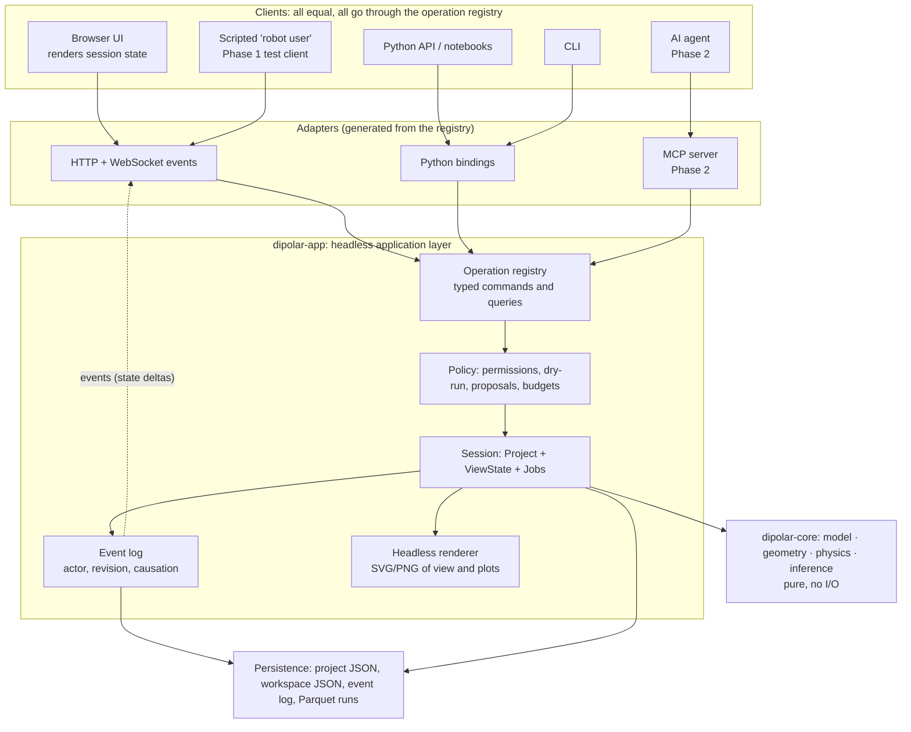

# AI-ready architecture: a headless engine with one tool surface

Version 0.3 · 2026-11-07 · Extends [03-redesign-plan.md](03-redesign-plan.md) (decisions D1–D12).
New decisions: **D13–D20**. v0.2 applied the GPT-6.1-Sol round-4 review, and v0.3 the round-5 minor changes
([round5-confirmation.md](validation/round5-confirmation.md)). See the round-4 review
([round4-ai-architecture-review.md](validation/round4-ai-architecture-review.md)).
Corrections are made in place, and the binding contracts are in **§8**, which overrides any
looser wording earlier in this document.

## 1. The owner's requirements

1. **Headless calculation engine.** All calculation logic runs without the UI.
2. **One tool surface for humans and agents.** A future AI agent must be able to *perform
   calculations* and *manage the view* with the **same tools** the UI uses.
3. **Phase 1 builds no agent**, but its architecture must not need a major refactor when the
   agent arrives in Phase 2.

## 2. Gap analysis of plan v0.3

| Area | v0.3 already provides | Gap for an agent |
|---|---|---|
| Science core | Pure `dipolar-core` with no I/O and no global state (D1, D8) | None. This is already headless. |
| Application logic | A FastAPI layer that serves the UI | **Not defined.** Validation, undo, job control and selection logic would naturally accumulate in React or in endpoints, which is the legacy "logic in dialog handlers" problem again. |
| Interface contract | OpenAPI types generated for the UI | Endpoints are designed for one screen; there are no tool descriptions, side-effect classes, preconditions or examples. |
| View | Panels, selection, camera, highlights | All of it lives **only in the browser**. An agent cannot see it or change it. |
| History | Undo/redo; immutable runs (D11) | There is no **actor** (user, script or agent), no command log, and no concurrent editing by two clients. |
| Safety | Local-backend controls (D10) | No permission tiers, dry runs, proposals or budgets for a non-human caller. |
| Perception | — | An agent cannot "see" the 3D view or the plots. |

**Conclusion.** The scientific core needs no change. What is missing is an **application
layer**: a headless, stateful session that owns every operation, including view operations.
Every client, the UI included, must go through it.

## 3. Target layering



**The UI is a renderer of session state plus a command emitter.** It holds only *transient*
state: hover, an in-progress drag, scroll position. Everything else, **including selection,
camera, visible layers and the active run**, is session state that any client can read and
change through commands.

## 4. New decisions

### D13 — One operation registry, every operation a typed tool

Every capability is an **operation**: either a *query* (read-only) or a *command* (changes
state). Each operation is declared once:

```python
@operation(
    name="coupling.add",
    kind="command",
    effect="model",                # model | view | compute | io | destructive
    summary="Add an observed dipolar coupling between two spins.",
    tier="propose",                # minimum agent tier, see D17 (users are 'apply')
    idempotent=False,
    cost="instant",                # instant | seconds | job
    examples=[...],                # validated in CI
)
def add_coupling(s: Session, p: AddCoupling) -> CouplingAdded: ...
```

- **Inputs and outputs are Pydantic models.** Physical quantities are typed
  (`Quantity[Hz]`, `Quantity[deg]`), so units are never implicit, and references are typed IDs
  (`SpinId`). Every output returns **both IDs and display labels**.
- **The other interfaces are generated from it.** Python API, CLI (Typer), HTTP routes and
  OpenAPI, the TypeScript client, and in Phase 2 the MCP tool list.
- **Rule: there is no private UI API.** A CI test fails if the frontend calls any endpoint that
  is not a registered operation. The UI therefore exercises the full agent surface every day.
- **Granularity.**
  - Fine-grained operations: `coupling.add`, `parameter.set_range`, `view.select`.
  - A few workflow operations: `fit.run_profile`, `dataset.import_csv`.
  - Phase 2 adds agent-oriented composites, built on top of these and never bypassing them.
- **Structured errors.** Every error carries a `code`, a `message`, the `offending_field` and a
  `hint`, for example `SPIN_NOT_FOUND`, `STEP_NOT_POSITIVE`, `RANK_DEFICIENT`. An agent can
  repair its own call; the UI shows the same hint.
- **Registry snapshot tests.** The full JSON schema of the registry is committed. Any change
  needs a version bump under D20.

Initial namespaces (Phase 1):

| Namespace | Examples |
|---|---|
| `project.*` | `create`, `open`, `save`, `describe`, `validate` (returns the validation tray) |
| `molecule.*` | `import_xyz`, `from_template(biphenyl)`, `list_spins`, `set_isotope` |
| `dataset.*` | `import_csv` (returns a reconciliation report), `confirm_mapping`, `list_couplings` |
| `coupling.*` | `add`, `update`, `remove` (returns its dependents first), `set_sigma` |
| `parameter.*` | `bind_torsion`, `set_value`, `set_range`, `fix`, `free` |
| `model.*` | `set_order_model`, `set_symmetry_frame`, `describe_identifiability` |
| `fit.*` | `preview` (a non-mutating query), `run`, `run_profile`, `run_scan` (returns a JobId) |
| `job.*` | `status`, `cancel`, `wait` (bounded), `list` |
| `result.*` | `summary` (validity flags, intervals, residuals), `compare`, `export` |
| `view.*` | `select`, `focus`, `camera.set`, `layers.set`, `highlight`, `panel.open`, `annotate` |
| `render.*` | `view_png`, `plot_svg(kind=residuals\|landscape\|obs_vs_calc)`, `describe_view` |
| `history.*` | `undo`, `redo`, `log` |

### D14 — The headless session and its event log

- **A session** = `Project` (the scientific model, persisted in `*.dipolar.json`) + `Workspace`
  (view state, persisted separately in `*.workspace.json` so that a camera move never dirties
  the science) + `Jobs`.
- **Each command produces events.** Every accepted command appends events
  `{seq, revision, actor, command, args_hash, causation_id, timestamp, inverse}` to a log
  (JSON Lines next to the project).
- **What the log provides:**
  - undo/redo of the **global chronological** science history (selective per-actor undo only if dependency checks pass; see §8.2);
  - an **audit trail**: who changed what, user or agent;
  - **replay**: rebuilding a project from its log is a test;
  - **multi-client sync**: the UI and an agent see each other's changes live, as a stream of
    event deltas.
- **Optimistic concurrency.** State-dependent mutating commands **must** carry the relevant `expected_revision` (§8.1). A conflict
  returns `REVISION_CONFLICT` with the current state. This prevents an agent and a human from
  silently overwriting each other, and it is the multi-client version of B46.
- **Runs record the actor and the revision** they were computed from. Stale detection (D11)
  compares revisions.
- **Sizing.** The beta has a single process and an in-memory session with an append-only
  journal. Snapshots every N events keep replay fast.

### D15 — View state is first-class and agent-controllable

`ViewState` (Pydantic) includes:

- the selection: a set of typed IDs;
- the focus target and the camera (position, target, up, projection);
- layer visibility (misfit arcs, S axes, labels, H atoms);
- highlighted couplings and **annotations** (callouts with text, anchored to IDs);
- the open workspace and panels, the active run and the plot configuration;
- the units and precision used for display.

**Rules:**

1. All view changes are `view.*` commands. An agent asking for "show me the worst coupling"
   issues `view.select` + `view.focus` + `view.highlight`, and the user's screen follows.
2. View commands are cheap and logged, but they have their **own undo stack**, separate from the
   science stack, so undoing a camera move never reverts a coupling edit.
3. **The beta has a single shared view.** Detached or per-client views are deferred. In Phase 2,
   while an agent is driving, the UI shows "Agent is pointing at…". Transient drag feedback stays
   local; only coalesced semantic view changes are committed.

### D16 — Headless rendering and perception

An agent must be able to perceive what the user sees, without a browser:

- **`render.describe_view`**: a compact structured summary covering the visible objects, the
  selection, the current fit status with its validity flags, the top residuals and any active
  warnings. This is the primary channel, because it is cheap and exact.
- **`render.plot_svg` / `render.view_png`**: server-side rendering from the same `ViewState`.
  Plots use Matplotlib (the publication path already decided in D2). The molecule is rendered
  from a **shared, renderer-independent scene description** (§8.4) by a Python SVG renderer that
  uses the **same projection, viewport and clipping conventions** as the browser, so it does not
  depend on WebGL. A headless-Chromium snapshot of the real
  UI is an optional extra.
- **Visual parity test.** For fixed views, the scene description, the projected 2D positions, the
  depth order and the visible and highlighted IDs agree within tolerance (§8.4).

### D17 — Agent-safety primitives built into Phase 1

These primitives are cheap to build now and very expensive to retrofit:

- **Actors and tiers.** The actor (`user`, `script`, `agent:<name>`) and its tier are **derived from
  the authenticated credential**, never taken from request arguments (§8.3). Tiers:
  - `read`: queries and `render.*`. View writes, compute, import, export and cancel are separate capabilities in the §8.3 matrix;
  - `propose`: mutations become **proposals**;
  - `apply`: mutations are applied directly;
  - `admin`: file I/O outside the project, and settings.
  Tokens are scoped per tier (this extends D10).
- **Dry run on every command.** `dry_run=true` returns the diff, the validation result and the
  cost without changing anything. The UI uses it for confirmations; agents use it to check a
  step before taking it.
- **Proposals.** A command from a `propose`-tier actor is stored as a pending change set. The
  user accepts it in the UI (in whole or in part), and acceptance replays it as a `user`-approved
  command. Phase 1 implements and tests this with the scripted robot; only the chat UI waits
  for Phase 2.
- **Budgets.** Per actor: maximum grid points, concurrent jobs, CPU-seconds and file size. These
  are enforced in the job runner and build on the D10 limits.
- **Treat inputs as data.** Imported labels, file contents and report text are never interpreted
  as instructions, tool outputs mark user-supplied strings as data fields, and `render.*` escapes
  everything. This is **hygiene, not a prompt-injection defence**: the defence is capability
  enforcement that does not depend on model text (§8.3), plus proposals that need human approval.
- **Determinism.** Seeds are explicit and runs are reproducible, so an agent's claims can be
  checked by replaying them.

### D18 — Long-running work is a resource, never a blocking call

`fit.run_scan` and similar operations return a `JobId` immediately, and progress is streamed as
events. `job.wait` exists but is bounded (`timeout ≤ 30 s`). Agents poll or subscribe; they
never hold a request open for minutes. Cancellation is a normal command (`job.cancel`).

### D19 — Self-describing scientific outputs

Every result query returns machine-interpretable content, not just numbers:

- the D3 **validity flags**: rank, joint rank, convergence, admissibility, interval support;
- the **estimand** and the convention, for example "jump-model φ, folded to [0°, 90°];
  equivalent at fixed labels: (±φ, Δ); (180±φ, −Δ) only with the ring-B relabelling H2′↔H6′, H3′↔H5′";
- the **assumptions** list and the **warnings** with codes;
- links to the run's provenance.

This does not by itself stop an agent from inventing claims. It makes every claim **traceable**: Phase 2 requires each generated statement to cite the fields it depends on, and the A4 evaluations measure ungrounded claims.
The same structure feeds the Phase 2 "explain this fit" and Methods-text features.

### D20 — Versioned tool contract

- **The registry has its own semantic version**, independent of the app version.
- **Compatibility rules.** Fields may be added; removing or renaming one needs a major version
  bump. Deprecated operations keep working for one minor release, with a warning event.
- **Contract tests.** A conformance suite runs the registry examples against every adapter
  (HTTP, Python, and MCP in Phase 2), so all interfaces behave identically.

## 5. What changes in the existing decisions

| Decision | Change |
|---|---|
| D1 (Python core) | Add the `dipolar-app` package: registry, session, event log, policy and renderer. `dipolar-core` stays pure. |
| D2 (UI) | The browser UI is the beta's only UI path (owner decision). It is a **thin client**: no business logic, all state in the session, a generated TS client, live event subscription. |
| D5 (IDs) | IDs also cover view objects (annotations, panels) and actors. |
| D6 (formats) | Adds `*.workspace.json` (view) and `*.events.jsonl` (log). The project file stays science-only. |
| D8 (UI as a client) | Strengthened into D13's "no private UI API" rule, enforced in CI. |
| D10 (local security) | Tokens are scoped per actor tier (D17). The agent transport in Phase 2 goes through the same policy layer. |
| D11 (durable runs) | Runs record the actor and the revision. The event log is fsynced with the same publication-order rules. |

## 6. Anti-goals, to avoid over-engineering in Phase 1

- **No LLM calls, no prompt files, no chat UI, no MCP server** in Phase 1.
- No distributed event store, CRDTs or multi-user server. The beta has one process and one local
  session; D14's revision checks are enough for one human and one agent.
- No speculative "AI tools". Phase 1 ships only the operations the beta UI needs, plus
  `render.*` and `describe_view`. These are justified anyway by tests, the CLI and headless
  report generation.

## 7. How Phase 1 *proves* AI-readiness without an AI

| Check | Pass condition |
|---|---|
| UI coverage | 100% of UI domain actions are registry operations. The CI scan of frontend calls allows only the §8.5 exceptions (auth, uploads/artifact bytes, event transport) and is backed by the dependency-boundary and behavioural-parity tests. |
| **Robot user** | A scripted, non-LLM client completes the whole biphenyl tutorial (create project → import couplings → confirm mapping → bind torsion → preview → profile fit → select the worst coupling → render a PNG → export) **only through HTTP registry calls**. The final project and results equal those of the UI path. |
| Replay | Rebuilding from `*.events.jsonl` reproduces the project hash |
| Proposals | The robot, as a `propose`-tier actor, creates a change set. The test accepts a **dependency-closed subset** (§8.3), and a non-closed subset is rejected. The state and the log are correct. |
| Concurrency | A UI edit and a robot edit at the same revision produce `REVISION_CONFLICT`, with no lost update |
| Perception | `describe_view` and `render.view_png` reflect a robot-issued `view.highlight`, and the browser shows it within 200 ms |
| Contract | The registry schema snapshot and the examples pass on both the HTTP and Python adapters |

Additional checks required by round 4 are listed in §8.6. If all of them pass, and the §8 contracts
are implemented, Phase 2 is expected to add an adapter (MCP), composite tools and a client
without restructuring the application.

## 8. Binding contracts (round-4 amendments)

### 8.1 Revision domains, concurrency and jobs

- **Four counters are kept separate:**
  1. the journal sequence (every event);
  2. the **science revision** and canonical science hash, which only scientific mutations advance;
  3. the **workspace revision** (view only);
  4. the job status.

  Camera moves, proposals and job progress never mark fits stale and never invalidate science
  writes.
- **State-dependent mutations require the relevant `expected_revision`.** A missing check is a
  validation error, not a bypass. Check-and-commit is **atomic** (a single writer lock in the beta).
  A conflict returns `REVISION_CONFLICT` with the current revision and a bounded description of
  the conflict, and **nothing is mutated**.
- **Idempotency keys.** Mutations accept a `request_id`. A retried request after a lost response
  returns the original outcome and never applies twice.
- **Jobs capture their scientific inputs at submission** (an immutable snapshot plus its hash) and
  publish results against that input identity.
  - A job that finishes after the science has changed publishes a **stale** result and never
    overwrites newer active state.
  - Cancellation and completion races resolve to exactly one terminal state, recorded in the
    journal.

### 8.2 Journal, replay and undo

- **Each event records** a command ID, the actor, the schema versions, and the **forward payload**
  (or immutable content references, such as a hash of an imported file stored in the project's
  blob store). It also records generated IDs, transaction boundaries, the inverse, and the
  snapshot lineage.
- **Commits are atomic transactions.** All events of one command are written as **a single
  transaction record** (one JSON Lines entry with a checksum). That record also holds the
  `request_id` and its outcome, which **persists the deduplication table**: a retry after a crash
  returns the stored outcome and cannot apply twice.
  - Order of writes: referenced blobs (for example imported files) are written and fsynced
    **before** the transaction record; then the record is fsynced; then the request is
    acknowledged.
  - Recovery discards any incomplete or checksum-failing final record. An uncommitted
    transaction leaves no partial state, and orphan blobs are garbage-collected.
  - Periodic snapshots record the sequence number they cover.
- **Replay applies recorded events.** It never re-runs jobs or external I/O; job results are
  referenced by run ID and hash.
- **Undo.**
  - The beta supports **global chronological undo** of the science history.
  - Selective per-actor undo is rejected unless a dependency check shows that no later event
    depends on the target.
  - Undo is a **new audited command**: revisions never decrease. Exported files and completed jobs
    are not undone; runs from undone states are marked stale.
  - The view undo stack is separate, and its entries that point to deleted objects or obsolete
    runs are skipped with a notice.

### 8.3 Trusted policy, capabilities, proposals and dry run

**Identity.** The principal and its capabilities come from the authenticated credential. An
`actor` field in arguments is ignored, or rejected if it disagrees with the credential.

**Capability matrix (beta).**

| Capability | read | propose | apply (human) | admin |
|---|---|---|---|---|
| Read-only queries (except `fit.preview`), `render.*`, `describe_view` | ✓ | ✓ | ✓ | ✓ |
| `fit.preview` (non-mutating, bounded) | within the preview budget | within the preview budget | ✓ | ✓ |
| `view.*` writes | — | ✓ (direct, logged) | ✓ | ✓ |
| Science mutations | — | as a proposal | ✓ | ✓ |
| Compute jobs (`fit.run*`, scans) | — | as a proposal | ✓ | ✓ |
| Import, export, file I/O | — | as a proposal (project scope only) | ✓ (project scope) | ✓ |
| `job.cancel` | — | own jobs only | ✓ | ✓ |

**Approval.** Only an authorized **human** principal can approve proposals. For a `propose`-tier agent:
- **Require approval:** science mutations, compute jobs, and imports and exports.
- **Applied directly and logged:** view writes, bounded previews, and cancelling its own jobs.

**Proposals.**
- Each proposal records its base science revision, its dependency graph, an expiry time, the
  proposer and the approver.
- Validation and acceptance are **atomic**. Partial acceptance is allowed only for
  dependency-closed subsets.
- A proposal whose base is stale is rejected or rebased, with an explicit conflict report.

**Dry run.** A dry run may read and validate bounded inputs. It **never** writes files, launches
jobs or consumes revisions, and its cost figure is an estimate.

**Prompt injection.** Defended by enforcing capabilities independently of any model text, plus
proposals by default. Escaping and data marking are hygiene only.

### 8.4 Perception parity

- There is one **scene description**, built by the session from `ViewState` plus the active run
  and the state snapshot. It contains stable IDs, coordinates, visibility, highlights, annotations,
  styles and the camera. Both the browser and the SVG renderer consume it.
- **The beta constrains the projection** to the browser's perspective camera parameters
  (field of view, near and far planes, viewport). The SVG renderer implements the same
  projection.
- **The parity test** compares projected positions, depth order and visible/highlighted IDs within
  tolerance, on fixed fixtures.
- `describe_view` reports the run and science revision it reflects, and whether they are
  **stale**. Tools target the single shared view.

### 8.5 Registry, coverage and contract versioning

**One typed dispatcher.** Adapters are thin wrappers around a single dispatcher that applies
policy and validation; they never duplicate that logic. The M0 spike proves that units, IDs,
errors and output schemas serialize to JSON.

**"No private UI API" covers all domain capabilities.** Authentication, uploads and artifact
bytes, and the event transport are explicit exceptions. Enforcement has three parts:
1. a scan of the endpoints the frontend calls;
2. **dependency-boundary checks**: the frontend may not import fitting, reconciliation or
   selection logic;
3. **behavioural parity tests**: robot vs UI.

**D20 breaking changes** include:
- new required inputs;
- narrowed ranges;
- changed defaults, units or effects;
- changed error semantics.

Unknown fields are rejected on input and ignored on output. **Unknown enum values are rejected on
input, before dispatch.** Only output decoding maps them to an explicit `unknown` variant. Removals happen only at a major version. Project schemas and event
schemas have their **own** migrations. Behavioural compatibility fixtures are kept alongside the
schema snapshot.

### 8.6 Additional AI-readiness checks (extend §7)

- The robot runs in a **clean process with no frontend or browser dependencies**.
- Policy-denial tests: no tier escalation through arguments.
- Rejection of stale proposals.
- View changes during running fits leave the science and the runs untouched.
- Deduplication after a disconnect and retry.
- Journal crash recovery, by killing the process mid-commit.
- Cross-actor undo conflicts.
- "Equal results" use quantity-specific tolerances; "within 200 ms" is measured on named hardware.

### 8.7 MCP adapter topology (Phase 2, decided now)

- **One session, many clients.** A locally launched MCP server (stdio) is a **thin bridge** that
  attaches to the **already running** `dipolar serve` session through authenticated local
  credentials. It never creates a second in-memory project. A remote option uses Streamable HTTP
  behind the same policy layer.
- **The protocol revision and SDK are pinned** when A1 starts.
- **Mapping:**
  - registry operations → MCP **tools**, with input and output schemas and structured outputs;
    error codes are mapped. Behaviour annotations are hints only, never authorization.
  - Session snapshots, run results and rendered artifacts → URI-addressed **resources**, with
    subscription where the client supports it and polling as a fallback.
  - Application `JobId`s stay application jobs, exposed through tools and resources. They are
    not assumed to be MCP-native tasks.
  - `job.cancel` is distinct from cancelling a transport request.
- **MCP is one optional adapter.** The registry stays usable through HTTP and Python for clients
  without MCP.
