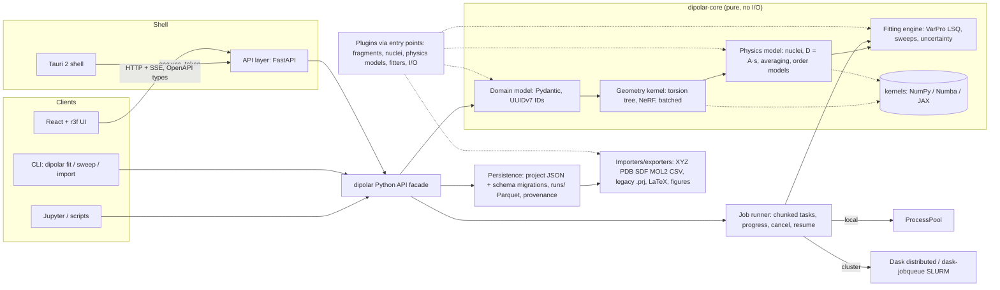

# Dipolar Studio: target architecture

Status: panel proposal, 2026-11-07. Inputs: `docs/legacy/01-legacy-analysis.md`,
`docs/legacy/02-bug-report.md` and `tools/legacy-harness`. Bug IDs (Bxx) refer to the bug report.

## 1. Stack

### Recommendation

| Layer | Choice | Main alternative | Why the choice wins |
|---|---|---|---|
| Scientific core | **Python 3.12+, NumPy, SciPy**, Numba for 2–3 hot kernels, JAX as an optional extra | Rust + PyO3/maturin | The maths is tiny dense linear algebra repeated millions of times, which batched NumPy handles well. Users are NMR chemists who extend Python, not Rust. |
| Public interface | **Python API first**, then CLI (Typer) and notebooks | GUI first | Reproducible science lives in scripts; the GUI is one client among several. |
| Service layer | **FastAPI + Pydantic v2** on 127.0.0.1, SSE for progress | JSON-RPC over stdio | One server backs desktop, browser (`dipolar serve`) and JupyterHub. Pydantic generates JSON Schema and OpenAPI, and from those the TS types. |
| UI | **React 19 + TypeScript (strict) + Vite**, TanStack Query, Zustand | Qt/PySide6 | Best 3D/table/plot ecosystem, and browser deployment for free. |
| 3D viewer/editor | **three.js via react-three-fiber + drei**: instanced atoms, picking, torsion gizmos, order-tensor glyphs | Mol*, NGL, 3Dmol.js | Molecules are small (<200 atoms) and the work is *editing*: picking spin pairs, dragging torsions. Mol* excels at viewing biomolecules but is awkward to edit with; NGL has slowed; 3Dmol.js is hard to extend. |
| Plots | Plotly.js (`scattergl`) interactive; **Matplotlib** for publication figures | ECharts, uPlot | One figure source: notebook and app export identical PDF/SVG. |
| Desktop shell | **Tauri 2** with the frozen Python backend as a sidecar | Electron | ~10× smaller installers. The cost is per-OS webview quirks (WebKitGTK), covered by Playwright on every OS. |

**What would change my mind**
- **Rust core**: if the fused Numba kernel stays below ~10⁶ points/s/core (§5 expects 1–3×10⁶), if we need Python-free in-browser compute (WASM), or if MD-trajectory averaging becomes core. The kernel boundary (§2) lets a PyO3 crate replace `dipolar.kernels` without API changes.
- **Mol\***, as a second read-only viewer, if weakly-aligned *protein* RDCs come into scope.
- **Electron** if WebKitGTK WebGL bugs block Linux users; only the shell changes.
- **PySide6** only if the owner rejects a JS toolchain outright.
- **Pyodide** (option, not plan of record): the same core in a Web Worker for a zero-install demo.

## 2. System architecture



Rules: `dipolar-core` does no I/O and holds no global state (the opposite of the legacy `GetDoc()`). Boundaries pass plain data (Pydantic models or NumPy arrays). The UI talks only to the API. Plugins are entry-point groups (`dipolar.fragments`, `.nuclei`, `.models`, `.fitters`, `.io`) that declare their parameters as JSON Schema, so the UI renders their forms with no frontend code.

## 3. Domain model

**Identity.** Every entity has an immutable UUIDv7 `id`; `label` is display-only and never used for lookup, which removes B11, B24, B25 and B29 by construction. Typed references (`AtomId`, `CouplingId`) are validated on load, so a dangling reference is a load error, not a silent (0,0,0).

```
Project(id, schema_version, meta, units_display)
├─ Molecule
│   ├─ atoms:  Atom(id, element, isotope?, label)
│   ├─ bonds:  Bond(id, a, b, order)
│   ├─ zmatrix / torsion tree: Node(atom, parent, angle_ref, dihedral_ref,
│   │          r: Dof, θ: Dof, φ: Dof)   ← rigid fragments are subtrees with fixed Dofs
│   └─ fragments: FragmentInstance(id, template="phenyl@1", atom_ids)  (provenance only)
├─ parameters: Parameter(id, dof_refs[], value, bounds, unit, prior?, tied_to?)
├─ couplings:  ObservedCoupling(id, spin_a, spin_b, value, sigma, observable=D|T=J+2D, sign_known)
├─ assignments: Assignment(coupling_id, components=[(spin_i, spin_j, weight)])
├─ order_model: OrderModel(kind=C1|D2|D4|uniaxial|distortion-rho, frame_def)
├─ conformer_model: Rigid | DiscreteRIS(conformers, populations) | plugin
└─ runs: [FitRunRef(id, hash)]           ← results live outside the project file
```

- **Geometry.** A molecular graph plus an internal-coordinate **torsion tree**, converted to Cartesian with NeRF (Natural Extension Reference Frame) using `atan2` and orthonormal frames, with no per-quadrant cases (B12–B14, B33). Phenyl, biphenyl and the branched fragment become **template plugins** that emit a subgraph and its Z-matrix. Arbitrary molecules arrive by XYZ/SDF import; the user then marks rotatable bonds.
- **Physics.** `D = A(geometry) · s`, with `s` the 5 independent order-matrix elements, reduced by the order model (D4: 2, D2: 3). Constants come from a `Nucleus` registry (CODATA γ, extensible to ¹³C, ¹⁵N, ³¹P); unknown pairs fail loudly, not K = 0 (B32). Averaging is an explicit weighted assignment matrix; an empty assignment is a validation error (B10).
- **Units.** Pint **only at the boundaries** (files, API, UI); the core uses plain floats in Å, rad and Hz, so kernels stay fast. Files store `{ "value": 1.397, "unit": "angstrom" }`, which ends the "mHz"/"Grados" mislabelling (B31).
- **Immutable fit runs.** A `FitRun` is write-once: `{id, created, project_sha256 of canonical inputs, method + config, seed, dipolar version + git SHA, numpy/scipy/numba versions, platform, wall time, status}`. Editing the project never alters a run; a run whose hash no longer matches is shown as *stale*.

## 4. File formats

| Purpose | Format |
|---|---|
| Project | `name.dipolar.json`: UTF-8, sorted keys, 2-space indent for clean git diffs. JSON Schema (2020-12) generated from Pydantic, committed to `schemas/`. Integer `schema_version` with a chain of pure `migrate_vN_to_vN+1(dict)` functions, each fixture-tested. Newer-version files open read-only. |
| Run results | `runs/<run-id>/run.json` (provenance) + `points.parquet` (one row per point: parameters, s, eigenvalues, χ², per-coupling residuals), Zstd, one partition per chunk. Parquet beats HDF5: the data is tabular, a crash leaves no corrupt monolith, and polars/DuckDB/R read it. **Zarr v3** only if dense N-d χ² landscapes are needed. |
| Sharing | `.dipolarz`: a zip of the project plus selected runs. |
| Import | XYZ, PDB, SDF/MOL, MOL2 via RDKit (optional extra; built-in XYZ/SDF fallback). Couplings as CSV (`spin_a,spin_b,value,sigma,unit,observable`) with an explicit atom-mapping step. |
| Export | CSV/Parquet; LaTeX (`booktabs` + `siunitx` uncertainties); PDF/SVG/PNG figures from Matplotlib styles; XYZ/SDF. |

**Legacy `.prj` importer: feasible, about 1 week.** Every class uses schema 0 (B21), so there is exactly one format, fully determined by the `Serialize` methods. `CProyectoDoc` writes: fragment list, `CMainFrame` combo strings, parameter/observed/component lists, two `CPunto`, `CDistorcion`, three `CParametro`, metadata strings, counters, the `pObjParteRigida` reference, grid settings, symmetry and units as *Spanish strings*. Each `CParteRigida` is 12×`CLado`, 6×`CSpin`, 12×`CAngulo` (value, state, label), 12×`CPunto` (3 doubles), the rotation angle and a type string.

A ~400-line Python reader decodes the CArchive primitives: little-endian `int`/`BOOL` (4 B) and `double` (8 B); `CString` with a 1/3/7-byte length prefix, where an `FF FE FF` marker means UTF-16 (so both the VC6 MBCS/cp1252 and the VS2013 Unicode builds work); `CObList` as a WORD count plus `WriteObject` records (`0xFFFF` new-class tag with schema and name, `0x8000|n` for a seen class, WORD back-references for seen objects).

Known losses go into an import report, not silence: bond-length bindings are never stored (B19); `pObjParteRigida` may dangle (B17) and is dropped; unresolvable label links are listed.

**Risk:** the legacy repo has no sample `.prj` files. The owner should look for thesis-era files; otherwise we build the VS2013 project on a `windows-latest` runner (MFC component) and script fixture saves. The `.par/.int/.ten` files are raw `StcParametro`/`StcValorDual` arrays whose record size (48/88 vs 88/168 B) reveals MBCS vs Unicode, so they are importable as an optional extra.

## 5. Performance

**Vectorization.** For G grid points, N atoms, P pairs:
1. Batched NeRF gives `X[G,N,3]`; only subtrees below a swept torsion are recomputed.
2. Pair vectors `R[G,P,3]` give r, cos θ and φ (`atan2`), hence `A[G,P,5]`, in O(G·P) with no Python loops.
3. Averaging is a sparse product `M[C,P] · A → A_obs[G,C,5]`.
4. Weighted least squares for `s` via batched normal equations (`np.linalg.solve` on `[G,5,5]`) with a per-point rank/condition check, so degenerate points are flagged, not garbage (B07). The legacy exact solve from 2–3 hand-picked couplings survives only as `method="legacy_exact"`.
5. `np.linalg.eigh` on `[G,3,3]` gives principal order parameters, replacing the broken Householder code (B01–B04).

Chunks of ~16k points keep the working set near 30 MB.

**Better algorithm.** The model is linear in `s` and nonlinear only in geometry, so it fits **variable projection**: `s` is eliminated analytically and `scipy.optimize.least_squares` runs over geometry only. A coarse grid seeds VarPro refinement of the best basins; uncertainty comes from the Jacobian (bootstrap optional, emcee as a plugin). A 5° grid plus refinement needs ~10ᵏ fewer points than a 0.5° grid over k parameters.

**Parallel and distributed.** A chunk is a pure function `(project_sha, method, index_range) → Parquet partition`, so chunks are idempotent and **resumable** (finished partitions are skipped). Locally: `ProcessPoolExecutor`, one worker per core; optionally Dask with `dask-jobqueue` for SLURM/PBS. Cancellation is a token checked between chunks (≤1 chunk latency) with hard kill as fallback. Progress (chunks done, ETA, best χ²) streams over SSE.

**Speedup estimate** (reasoned; the M2 benchmark confirms it). Reference: biphenyl-type, 10 spins, 45 pairs, 15 couplings, 3 parameters × 100 steps = 10⁶ points.
- *Legacy:* object-graph rebuild with `CString` lookups, per-pair trig and Gauss: ~20–100 µs/point. The default tolerance accepts nearly every point (B08), each costing three file open/close cycles (~0.5–3 ms). Total ~10 min–1 h, single-threaded.
- *New:* ~4 kFLOP/point. Chunked NumPy ~2–5 µs/point/core, fused Numba ~0.3–1 µs; on 8 cores ~0.05–0.15 µs/point, so **~0.1–5 s** in total.
- *Net:* **~10²–10⁴×** on the same grid (I/O removal 10–100×, vectorization 10–50×, ×cores). Coarse grid + VarPro saves a further 10–1000× for k ≥ 2.

## 6. Quality

**Test pyramid**
- **Unit** (pytest, ~70%): NeRF placement, dipolar constants vs γ ratios, coefficient formulas, order models, migrations, parsers.
- **Property-based** (Hypothesis): `D` invariant under a joint rigid rotation of molecule and order tensor; tensor traceless and symmetric; `D` symmetric in the spin pair and ∝ r⁻³; Z-matrix ↔ Cartesian and project JSON (with every migration chain) round-trip; batched kernel equals the scalar reference.
- **Golden** (`tools/legacy-harness`): correct legacy outputs (D4 diagonal, full Gauss) match to 1e-12; the "golden failures" (B01–B03, B06) must match NumPy, not the bug; curated, cited published LC-NMR datasets reproduce within their stated uncertainty.
- **Snapshot**: small seeded sweeps with Parquet checksums; figures via `pytest-mpl`.
- **Frontend**: Vitest + Testing Library; a contract test fails CI if the OpenAPI spec and generated TS types drift.
- **End-to-end** (Playwright) against `dipolar serve` on 3 OSes: build, enter couplings, fit, cancel a sweep, export LaTeX. Desktop smoke tests via `tauri-driver` on Windows/Linux; macOS (no WKWebView driver) gets a scripted launch check.

**CI** (GitHub Actions): `{ubuntu, windows, macos} × Python per SPEC 0 (now 3.12–3.14)` plus Node LTS. `uv` (lockfile), `ruff`, `pyright --strict` on core, `tsc --strict --noUncheckedIndexedAccess`, ESLint `strict-type-checked` + Prettier, pre-commit, coverage gates (90% core, 70% overall), and a nightly `pytest-benchmark` job that fails on a >20% regression.

**Docs**: MkDocs Material + mkdocstrings + mkdocs-jupyter, with notebooks **executed in CI** so stale examples break the build. Keep config portable, as upstream has announced a successor (Zensical). Sections: tutorials, how-tos, theory with explicit conventions (sign of D, T = J + 2D), API reference, legacy migration guide.

**Release**: tag-driven SemVer; PyPI **trusted publishing** with Sigstore attestations; a conda-forge feedstock; Tauri bundles as a signed `.msi` (Azure Trusted Signing), a notarized `.dmg`, and AppImage/`.deb`/Flatpak; signed updater manifests and a CycloneDX SBOM per release.

**Licence: BSD-3-Clause.** It is the scientific-Python norm (NumPy, SciPy, Matplotlib), compatible with every dependency above, and lets NMR vendors and pharma embed the code. MIT is nearly equivalent, but BSD-3's non-endorsement clause suits university-affiliated work; GPL would block vendor integration for little gain. The rewrite is clean-room: legacy code is a *specification*, not copied, since ownership of the 1998 thesis code is unclear.

**Citation**: `CITATION.cff` (CFF 1.2) with authors, ORCIDs and the thesis as a `references:` entry; Zenodo GitHub integration mints a DOI per release plus a concept DOI; a JOSS paper at 1.0.

## 7. Repository layout

```
dipolar-studio/
├─ pyproject.toml            # uv workspace root, ruff/pyright config
├─ package.json              # pnpm workspace root
├─ packages/
│  ├─ dipolar-core/          # PyPI: dipolar
│  │  └─ src/dipolar/
│  │     ├─ model/           # Pydantic entities, IDs, validation
│  │     ├─ geometry/        # torsion tree, NeRF, batched builders
│  │     ├─ physics/         # nuclei, coefficients, order & conformer models
│  │     ├─ fit/             # varpro, sweep, legacy_exact, uncertainty
│  │     ├─ kernels/         # numpy / numba / jax backends (swappable, Rust-ready)
│  │     ├─ jobs/            # chunking, pool, dask, cancel, progress, resume
│  │     ├─ io/              # project json + migrations, parquet, xyz/sdf/pdb/mol2, csv, latex, figures
│  │     │  └─ legacy/       # CArchive reader, .prj mapper, .par/.int/.ten
│  │     ├─ plugins/         # entry-point registry + built-in fragments (phenyl, biphenyl, branched)
│  │     ├─ units.py         # pint boundary conversions
│  │     └─ api.py, cli.py
│  └─ dipolar-server/        # FastAPI app, SSE, auth token, OpenAPI export
├─ apps/
│  ├─ web/                   # React + TS + Vite + r3f; src/api is generated from OpenAPI
│  └─ desktop/               # Tauri 2 (src-tauri/), sidecar packaging scripts
├─ schemas/                  # project.v1.schema.json … (generated, committed)
├─ tests/
│  ├─ golden/                # legacy-harness cases, reference datasets
│  ├─ fixtures/prj/          # legacy project files
│  └─ e2e/                   # Playwright
├─ examples/notebooks/       # executed in CI, included in docs
├─ benchmarks/
├─ docs/                     # mkdocs; legacy/ and panel/ kept
├─ tools/legacy-harness/
├─ .github/workflows/        # ci.yml, e2e.yml, release.yml, bench.yml, docs.yml
├─ CITATION.cff  LICENSE  CONTRIBUTING.md  CODE_OF_CONDUCT.md
```

## 8. Phased delivery

Sizes assume 1–2 developers. The total is about 6–8 months to 1.0.

| Phase | Deliverables | Exit criteria | Size |
|---|---|---|---|
| **M0 Foundations** | Monorepo scaffold, CI on 3 OSes, licence, CITATION.cff, pre-commit, harness cases ported as pytest goldens (expected to fail at first), docs skeleton | CI green on an empty package; golden tests collected; ADRs for stack and licence merged | 1–2 wk |
| **M1 Scientific core + Python API** | Domain model with IDs, torsion tree + NeRF, nuclei registry, coefficient kernel, order models (C1/D2/D4/ρ-distortion), weighted LSQ + VarPro, `legacy_exact`, project JSON v1 + schema, XYZ/SDF + CSV import, 3 tutorial notebooks | All harness goldens pass (bugs B01–B07, B12–B14 shown fixed); Hypothesis suite green with 10⁴ examples; one published dataset reproduced; pyright strict clean | 5–6 wk |
| **M2 Sweeps & jobs** | Batched sweep kernel (+ Numba), chunked runner, cancel/progress/resume, Dask backend, Parquet runs + provenance, CLI | Reference 10⁶-point sweep in ≤10 s on an 8-core laptop; cancellation in ≤1 s; killing and resuming produces byte-identical results; cross-OS results agree to 1e-10 relative | 3–4 wk |
| **M3 Server + Web UI MVP** | FastAPI + generated TS client, r3f builder (templates, import, torsion drag, spin picking), coupling/assignment tables with validation, run panel with live progress, results explorer (Plotly, best-N, tensor glyphs), `dipolar serve` | Playwright workflow test green on 3 OSes; a new user completes the biphenyl tutorial in under 15 minutes without docs (hallway test); no TS `any` | 6–8 wk |
| **M4 Desktop, legacy import, exports** | Tauri bundles with sidecar, signing and notarization, `.prj` + `.par/.int/.ten` importers with an import report, LaTeX/CSV/figure export, `.dipolarz` | Signed installers install and run offline on clean VMs of all 3 OSes; every available legacy `.prj` imports with a reviewed diff report; exported tables compile in a LaTeX CI job | 4–5 wk |
| **M5 1.0** | Stable plugin API (one external example plugin, e.g. ¹³C or RIS conformers), complete docs, conda-forge, Zenodo DOI, JOSS submission | API frozen under SemVer; at least 2 external beta users have reproduced results; docs build with all notebooks executed; 0 open S1 issues | 3–4 wk |
